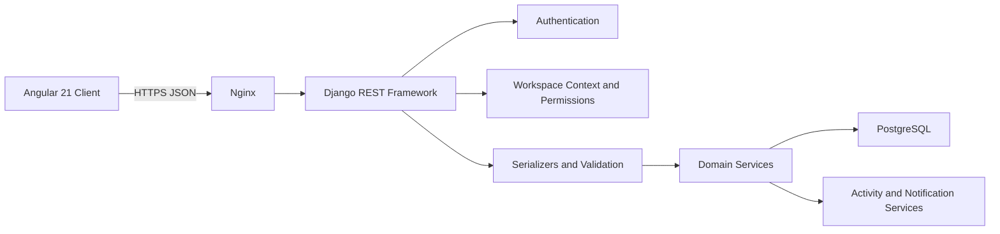

# Infraon Flow — API Design Document

**Version:** 1.0  
**Status:** Draft for engineering implementation  
**Date:** 22 October 2026  
**Product:** Infraon Flow  
**Backend:** Python, Django, Django REST Framework  
**API style:** REST over HTTPS  
**Base path:** `/api/v1/`  
**Database:** PostgreSQL

---

## 1. Purpose

This document defines the API contract for Infraon Flow. It translates the product requirements, system architecture, and database design into resource-oriented endpoints, request and response conventions, authentication rules, authorization behavior, validation, filtering, and representative payloads.

The API is designed for the Angular 21 frontend and a modular Django REST Framework backend. It is an implementation baseline; endpoint names and payload details may be refined during development, but tenant isolation, authorization, and business invariants are mandatory.

## 2. API design principles

1. REST resource conventions with predictable nouns and HTTP methods.
2. All endpoints use the `/api/v1/` versioned prefix.
3. JSON request and response bodies using `application/json`.
4. UUID identifiers for business entities.
5. Workspace context is explicit and validated on the server.
6. Authentication and authorization are enforced by the backend, never by frontend route guards alone.
7. List endpoints are paginated and support documented filters and ordering.
8. Mutations validate business rules and database constraints.
9. Consistent error response structure.
10. API schema is published through OpenAPI using `drf-spectacular`.

## 3. High-level API architecture



The frontend communicates only with the API. Domain logic lives in backend services, not in Angular components or serializers alone.

## 4. Base URL and versioning

Local development:

`http://localhost:8000/api/v1/`

Production example:

`https://<application-domain>/api/v1/`

Versioning rules:
- Breaking changes require a new major API path, for example `/api/v2/`.
- Additive optional fields and endpoints can be introduced within v1.
- Do not silently change the meaning or type of an existing field.
- Deprecate fields with documentation and a migration window before removal.

## 5. Request conventions

### 5.1 Headers

| Header | Required | Purpose |
|---|---|---|
| `Authorization: Bearer <access_token>` | Yes for protected routes | JWT access token |
| `Content-Type: application/json` | For JSON body | Request media type |
| `Accept: application/json` | Recommended | Expected response |
| `X-Workspace-ID: <uuid>` | For workspace-scoped routes | Active workspace context |
| `Idempotency-Key: <value>` | Optional for retry-sensitive creates | Prevent duplicate processing where implemented |

The `X-Workspace-ID` header is a context selector, not proof of access. The API must verify that the authenticated user has an active membership in the requested workspace. Never trust a workspace ID supplied in the body to establish access.

### 5.2 Naming and formats

- JSON keys use `snake_case` to match Django serializers and database naming.
- IDs are UUID strings.
- Dates use ISO 8601 date format: `YYYY-MM-DD`.
- Timestamps use ISO 8601 with UTC offset, preferably `Z`.
- Decimal metric values are serialized as strings or JSON numbers consistently; recommendation: strings for exact decimal preservation in KR values.
- Empty optional values use `null`; omitted fields are reserved for PATCH semantics or documented defaults.
- Boolean fields use `true` / `false`.

### 5.3 Example request

```http
GET /api/v1/tasks/?status=in_progress&priority=high&page=1&page_size=25
Authorization: Bearer <access_token>
X-Workspace-ID: 4b36f0f0-7f6a-4e8e-8d8b-9d2b5f0a9e20
Accept: application/json
```

## 6. Authentication

### 6.1 JWT flow

Recommended flow:
1. User submits credentials to the login endpoint.
2. API validates credentials and returns a short-lived access token.
3. Refresh token is stored in a Secure, HttpOnly, SameSite cookie where deployment architecture supports cookie-based refresh.
4. Angular sends the access token as a Bearer token.
5. When access expires, frontend calls refresh endpoint; backend rotates refresh token.
6. Logout revokes/blacklists the refresh token and clears the cookie.

Access tokens should be short-lived (for example, 5–15 minutes; final value is an operational decision). Refresh token lifetime and rotation policy must be finalized before production. Never store plaintext passwords or expose refresh tokens in logs.

### 6.2 Authentication endpoints

| Method | Endpoint | Purpose | Auth |
|---|---|---|---|
| POST | `/auth/register/` | Register user | Public |
| POST | `/auth/login/` | Login and issue tokens | Public |
| POST | `/auth/refresh/` | Rotate/refresh access token | Refresh cookie/token |
| POST | `/auth/logout/` | Revoke refresh session | Authenticated |
| GET | `/auth/me/` | Current user profile | Required |
| PATCH | `/auth/me/` | Update current profile/timezone | Required |
| POST | `/auth/password/change/` | Change password | Required |

#### Register

`POST /auth/register/`

```json
{
  "email": "alex@example.com",
  "password": "Strong-password-value",
  "first_name": "Alex",
  "last_name": "Morgan"
}
```

Response `201 Created`:

```json
{
  "id": "6f05d3ec-b9df-4a35-ae95-5e67fb98d0c0",
  "email": "alex@example.com",
  "first_name": "Alex",
  "last_name": "Morgan"
}
```

The API may create a personal workspace during registration if that onboarding decision is adopted. Do not implicitly create a business workspace without an explicit user action.

#### Login

`POST /auth/login/`

```json
{
  "email": "alex@example.com",
  "password": "Strong-password-value"
}
```

Response `200 OK` (illustrative; refresh token may be set as cookie):

```json
{
  "access": "<jwt-access-token>",
  "user": {
    "id": "6f05d3ec-b9df-4a35-ae95-5e67fb98d0c0",
    "email": "alex@example.com",
    "first_name": "Alex",
    "last_name": "Morgan"
  }
}
```

## 7. Workspace and membership APIs

| Method | Endpoint | Purpose |
|---|---|---|
| GET | `/workspaces/` | List workspaces available to current user |
| POST | `/workspaces/` | Create workspace |
| GET | `/workspaces/{workspace_id}/` | Workspace details |
| PATCH | `/workspaces/{workspace_id}/` | Update workspace |
| GET | `/workspaces/{workspace_id}/members/` | List members |
| PATCH | `/workspaces/{workspace_id}/members/{membership_id}/` | Change role/status |
| DELETE | `/workspaces/{workspace_id}/members/{membership_id}/` | Remove member / set membership left |
| POST | `/workspaces/{workspace_id}/invitations/` | Invite by email |
| GET | `/workspaces/{workspace_id}/invitations/` | List invitations |
| POST | `/invitations/accept/` | Accept invitation token |
| POST | `/workspaces/{workspace_id}/invitations/{id}/revoke/` | Revoke invitation |
| GET | `/workspaces/{workspace_id}/teams/` | List teams |
| POST | `/workspaces/{workspace_id}/teams/` | Create team |
| GET | `/teams/{team_id}/` | Team detail |
| PATCH | `/teams/{team_id}/` | Update team |
| GET | `/teams/{team_id}/members/` | List team members |
| POST | `/teams/{team_id}/members/` | Add team member |
| DELETE | `/teams/{team_id}/members/{membership_id}/` | Remove team member |

Workspace create example:

```json
{
  "name": "Product Engineering",
  "workspace_type": "business",
  "description": "Engineering goals and delivery"
}
```

Response `201 Created`:

```json
{
  "id": "4b36f0f0-7f6a-4e8e-8d8b-9d2b5f0a9e20",
  "name": "Product Engineering",
  "slug": "product-engineering",
  "workspace_type": "business",
  "status": "active",
  "current_user_role": "admin",
  "created_at": "2026-10-22T05:30:00Z"
}
```

## 8. OKR APIs

### 8.1 Objectives

| Method | Endpoint | Purpose |
|---|---|---|
| GET | `/objectives/` | List objectives |
| POST | `/objectives/` | Create objective |
| GET | `/objectives/{objective_id}/` | Objective detail |
| PATCH | `/objectives/{objective_id}/` | Update objective |
| DELETE | `/objectives/{objective_id}/` | Archive/cancel objective according to policy |
| POST | `/objectives/{objective_id}/activate/` | Activate draft |
| POST | `/objectives/{objective_id}/complete/` | Mark completed |
| GET | `/objectives/{objective_id}/key-results/` | List objective KRs |
| POST | `/objectives/{objective_id}/key-results/` | Create KR under objective |

Objective create example:

```json
{
  "title": "Improve customer onboarding experience",
  "description": "Reduce friction in the first 30 days",
  "level": "team",
  "team_id": "0a68fd28-2d0a-4dc6-b8df-3b3b33c6d41a",
  "parent_objective_id": null,
  "owner_id": "6f05d3ec-b9df-4a35-ae95-5e67fb98d0c0",
  "period_name": "Q4 2026",
  "start_date": "2026-10-01",
  "end_date": "2026-12-31"
}
```

Response `201 Created`:

```json
{
  "id": "e55e3b1c-9e0a-4f70-81d2-6abdd0ab38f3",
  "workspace_id": "4b36f0f0-7f6a-4e8e-8d8b-9d2b5f0a9e20",
  "title": "Improve customer onboarding experience",
  "level": "team",
  "status": "draft",
  "progress": "0.00",
  "team_id": "0a68fd28-2d0a-4dc6-b8df-3b3b33c6d41a",
  "owner_id": "6f05d3ec-b9df-4a35-ae95-5e67fb98d0c0",
  "start_date": "2026-10-01",
  "end_date": "2026-12-31",
  "created_at": "2026-10-22T05:30:00Z"
}
```

### 8.2 Key results

| Method | Endpoint | Purpose |
|---|---|---|
| GET | `/key-results/` | List KRs across workspace |
| GET | `/key-results/{key_result_id}/` | KR detail |
| PATCH | `/key-results/{key_result_id}/` | Update KR definition/metadata |
| DELETE | `/key-results/{key_result_id}/` | Archive KR |
| POST | `/key-results/{key_result_id}/check-ins/` | Record progress check-in |
| GET | `/key-results/{key_result_id}/check-ins/` | Check-in history |
| GET | `/key-results/{key_result_id}/initiatives/` | List initiatives |
| POST | `/key-results/{key_result_id}/initiatives/` | Create initiative |

Key result create example:

```json
{
  "title": "Increase onboarding completion rate",
  "metric_type": "increase",
  "unit": "%",
  "start_value": "55.00",
  "current_value": "55.00",
  "target_value": "85.00",
  "owner_id": "6f05d3ec-b9df-4a35-ae95-5e67fb98d0c0",
  "start_date": "2026-10-01",
  "due_date": "2026-12-31"
}
```

Check-in create example:

```json
{
  "value": "68.50",
  "confidence": "medium",
  "notes": "New onboarding checklist is live for two customer segments.",
  "blockers": "Analytics event coverage is incomplete.",
  "next_steps": "Complete event instrumentation and review cohort data."
}
```

The backend computes progress using the KR metric type and values, stores a check-in history record, and updates the current KR snapshot in one transaction. Clients must not submit an arbitrary progress percentage as authoritative for numeric KRs.

### 8.3 Progress contract

- Increasing metric: `(current_value - start_value) / (target_value - start_value) * 100`.
- Decreasing metric: `(start_value - current_value) / (start_value - target_value) * 100`.
- Binary: 0 or 100 based on explicit completion.
- Milestone: progress is based on defined milestone behavior or controlled manual updates.
- Clamp display progress to 0–100 and reject invalid denominators/targets.
- Objective progress is the unweighted average of eligible active KR progress values for MVP.
- Task completion never changes KR progress automatically.

## 9. Initiative APIs

| Method | Endpoint | Purpose |
|---|---|---|
| GET | `/initiatives/` | List initiatives |
| POST | `/initiatives/` | Create initiative |
| GET | `/initiatives/{initiative_id}/` | Initiative detail |
| PATCH | `/initiatives/{initiative_id}/` | Update initiative |
| DELETE | `/initiatives/{initiative_id}/` | Archive/cancel initiative |
| GET | `/initiatives/{initiative_id}/tasks/` | List linked tasks |
| POST | `/initiatives/{initiative_id}/tasks/` | Create task linked to initiative |

Example:

```json
{
  "title": "Redesign onboarding checklist",
  "description": "Improve guidance and reduce incomplete onboarding",
  "owner_id": "6f05d3ec-b9df-4a35-ae95-5e67fb98d0c0",
  "priority": "high",
  "start_date": "2026-10-25",
  "due_date": "2026-11-20"
}
```

The key result is supplied by the nested route. If a standalone initiative create endpoint is used, require `key_result_id` and validate same-workspace ownership.

## 10. Task and subtask APIs

| Method | Endpoint | Purpose |
|---|---|---|
| GET | `/tasks/` | List/filter tasks |
| POST | `/tasks/` | Create task |
| GET | `/tasks/{task_id}/` | Task detail |
| PATCH | `/tasks/{task_id}/` | Update task |
| DELETE | `/tasks/{task_id}/` | Archive/cancel task |
| POST | `/tasks/{task_id}/complete/` | Mark task done |
| POST | `/tasks/{task_id}/reopen/` | Reopen task |
| GET | `/tasks/{task_id}/subtasks/` | List subtasks |
| POST | `/tasks/{task_id}/subtasks/` | Create subtask |
| GET | `/tasks/{task_id}/comments/` | List comments |
| POST | `/tasks/{task_id}/comments/` | Add comment |

Task create example (unlinked task):

```json
{
  "title": "Review API authentication flow",
  "description": "Validate login, refresh and logout behavior",
  "initiative_id": null,
  "assignee_id": "6f05d3ec-b9df-4a35-ae95-5e67fb98d0c0",
  "priority": "high",
  "status": "todo",
  "start_at": "2026-10-23T09:00:00Z",
  "due_at": "2026-10-24T12:00:00Z"
}
```

Subtask create example:

```json
{
  "title": "Test refresh token rotation",
  "assignee_id": "6f05d3ec-b9df-4a35-ae95-5e67fb98d0c0",
  "priority": "medium",
  "due_at": "2026-10-24T10:00:00Z"
}
```

Rules:
- `initiative_id` is optional.
- `parent_task_id` is assigned by the nested subtask route; clients should not set arbitrary parent IDs through general task create.
- Parent and child tasks must belong to the same workspace.
- MVP recommends one subtask level.
- Completing a task updates its status and `completed_at`; it does not change key-result values or progress.
- Only permitted users may change assignee, status, or priority.

## 11. My Day APIs

| Method | Endpoint | Purpose |
|---|---|---|
| GET | `/my-day/?date=YYYY-MM-DD` | Get a user's daily plan and due/overdue tasks |
| POST | `/my-day/items/` | Add a task to a date plan |
| PATCH | `/my-day/items/{item_id}/` | Reorder/update plan note |
| DELETE | `/my-day/items/{item_id}/` | Remove from daily plan |

Add item example:

```json
{
  "task_id": "b43e4c56-cd18-41c2-a8e5-7b23d8eec0b7",
  "plan_date": "2026-10-23",
  "sort_order": 1,
  "note": "Complete before the API review"
}
```

Daily planning does not modify the task's `due_at`. The response should distinguish planned tasks, tasks due that day, and overdue tasks.

## 12. Dashboard and reports APIs

| Method | Endpoint | Purpose |
|---|---|---|
| GET | `/dashboard/summary/` | Workspace summary cards |
| GET | `/dashboard/okr-progress/` | Objective/KR progress overview |
| GET | `/dashboard/task-summary/` | Task counts by status/priority |
| GET | `/dashboard/team-progress/` | Team-level progress summary |
| GET | `/reports/okr-progress/` | Filterable OKR report |
| GET | `/reports/task-completion/` | Task completion report |

Dashboard responses should be purpose-built aggregate payloads, not huge nested lists. Apply workspace and permission scoping before aggregation. Document the date window and inclusion rules for each metric.

## 13. Collaboration APIs

| Method | Endpoint | Purpose |
|---|---|---|
| GET | `/activity/` | Workspace activity feed |
| GET | `/notifications/` | Current user's notifications |
| POST | `/notifications/{notification_id}/read/` | Mark notification read |
| POST | `/notifications/read-all/` | Mark all as read |
| GET | `/initiatives/{id}/comments/` | Initiative comments |
| POST | `/initiatives/{id}/comments/` | Add initiative comment |
| GET | `/key-results/{id}/comments/` | KR comments |
| POST | `/key-results/{id}/comments/` | Add KR comment |

Activity feeds must not reveal records outside the active workspace or the viewer's permission scope. Avoid exposing sensitive internal metadata.

## 14. List, filtering, sorting, and pagination

### 14.1 Pagination

Recommended page-number pagination:

`?page=1&page_size=25`

Default page size: 25. Maximum: 100.

Example response:

```json
{
  "count": 142,
  "next": "https://api.example.com/api/v1/tasks/?page=2",
  "previous": null,
  "results": [
    {
      "id": "b43e4c56-cd18-41c2-a8e5-7b23d8eec0b7",
      "title": "Review API authentication flow",
      "status": "in_progress",
      "priority": "high"
    }
  ]
}
```

For high-volume feeds, consider cursor pagination later.

### 14.2 Common filters

| Resource | Query parameters |
|---|---|
| Objectives | `status`, `level`, `owner_id`, `team_id`, `period_name`, `start_date`, `end_date` |
| Key results | `objective_id`, `owner_id`, `status`, `metric_type` |
| Initiatives | `key_result_id`, `owner_id`, `status`, `priority`, `due_before`, `due_after` |
| Tasks | `assignee_id`, `created_by_id`, `initiative_id`, `parent_task_id`, `status`, `priority`, `due_before`, `due_after`, `overdue`, `search` |
| Activity | `actor_id`, `entity_type`, `entity_id`, `since` |
| Notifications | `unread`, `notification_type` |

Sorting uses `?ordering=due_at` or `?ordering=-created_at`. Only allowlisted fields may be used for ordering.

## 15. Standard response and error formats

### 15.1 Success

Single resource:

```json
{
  "id": "uuid",
  "title": "Example resource",
  "created_at": "2026-10-22T05:30:00Z",
  "updated_at": "2026-10-22T05:30:00Z"
}
```

Paginated list uses the structure in Section 14.

### 15.2 Error contract

Use a consistent structure:

```json
{
  "error": {
    "code": "validation_error",
    "message": "The request contains invalid fields.",
    "details": {
      "due_date": ["End date must be on or after start date."]
    },
    "request_id": "req_01J..."
  }
}
```

Recommended codes:

| HTTP status | Code | Meaning |
|---|---|---|
| 400 | `validation_error` | Invalid input or business rule |
| 401 | `authentication_required` | Missing/invalid/expired authentication |
| 403 | `permission_denied` | Authenticated but not permitted |
| 404 | `not_found` | Resource unavailable in current scope |
| 409 | `conflict` | State or uniqueness conflict |
| 413 | `payload_too_large` | Request body exceeds limit |
| 429 | `rate_limited` | Too many requests |
| 500 | `internal_error` | Unexpected server failure |

Use `404` for inaccessible cross-workspace resource IDs where appropriate to reduce resource enumeration. Do not expose stack traces or database errors.

## 16. Authorization model

### 16.1 Workspace roles

| Capability | Workspace Admin | Team Lead | Member |
|---|---:|---:|---:|
| View workspace data | Yes | Yes | Yes, within workspace |
| Manage workspace settings | Yes | No | No |
| Invite/manage members | Yes | Limited if explicitly granted | No |
| Create/manage teams | Yes | Limited by policy | No |
| Create objectives/KRs | Yes | Yes | Yes, subject to policy |
| Update any workspace OKR | Yes | Team scope | Own/assigned scope |
| Create tasks | Yes | Yes | Yes |
| Assign tasks to others | Yes | Team scope | Policy-controlled |
| View workspace reports | Yes | Team scope | Personal/allowed scope |

This is a starting role matrix. Fine-grained permission policy must be implemented and tested before pilot.

### 16.2 Enforcement rules

- Authenticate every protected request.
- Resolve `X-Workspace-ID` and verify active membership.
- Scope every queryset by workspace.
- Validate object relationships belong to the same workspace.
- Apply role and ownership permissions to each mutation.
- Never rely on Angular guards or hidden controls for authorization.
- Log sensitive role, membership, and ownership changes.

## 17. Business transaction rules

| Operation | Required atomic behavior |
|---|---|
| Create workspace | Workspace + creator admin membership |
| Accept invitation | Validate token + create/activate membership + mark invitation accepted |
| Create objective with KRs | Objective + KRs |
| KR check-in | Create check-in + update KR current value/progress/status + recalculate objective progress |
| Complete task | Update task status/completed timestamp + activity event |
| Move task to initiative | Validate same workspace + update relationship + activity event |
| Change membership role | Permission check + update role + activity event |

Use Django `transaction.atomic()` and row locking where concurrent updates can conflict.

## 18. Idempotency and concurrency

- Support `Idempotency-Key` for selected create operations where retries could create duplicates (for example, invitation acceptance or externally retried submissions).
- Store idempotency keys with user, workspace, endpoint, request hash, response status/body, and expiry if implemented.
- For ordinary updates, consider an `updated_at` or version-based optimistic concurrency check.
- Return `409 Conflict` when a stale update cannot safely be applied.
- Do not promise idempotency for endpoints until server-side storage and replay behavior are implemented.

## 19. Security requirements

- HTTPS only outside local development.
- Short-lived access JWTs; refresh rotation and revocation.
- Secure, HttpOnly, SameSite refresh cookie if cookie-based refresh is selected; implement CSRF protection for cookie-authenticated refresh/logout flows.
- Rate-limit registration, login, password change, invitation, and other abuse-prone endpoints.
- Validate request sizes and field lengths.
- Restrict CORS to trusted frontend origins.
- Do not expose password hashes, token hashes, secrets, or sensitive activity metadata.
- Use parameterized ORM queries; avoid raw SQL unless parameterized and reviewed.
- Prevent IDOR by checking workspace membership and object-level access.
- Record security-relevant events without logging credentials or bearer tokens.

## 20. OpenAPI and API documentation

Use `drf-spectacular` to publish:
- OpenAPI JSON: `/api/schema/`
- Swagger UI: `/api/docs/`
- ReDoc: `/api/redoc/`

Document every endpoint's:
- Authentication requirement
- Workspace header requirement
- Role/permission requirement
- Path/query parameters
- Request schema and response schema
- Validation errors and status codes
- Pagination/filter/order behavior
- Side effects and transaction behavior

Keep schema generation in CI and review schema changes as part of pull requests.

## 21. Testing strategy

### 21.1 Required API tests

1. Authentication success, failure, expiration, refresh rotation, and logout.
2. User can list only workspaces where they have membership.
3. Cross-workspace reads and writes are rejected.
4. A team, objective, KR, initiative, task, and assignee cannot be cross-linked across workspaces.
5. Role permissions are enforced for each mutation.
6. Task creation works with and without an initiative.
7. Subtask parent must be in the same workspace.
8. My Day planning does not mutate task due date.
9. KR progress formulas cover increase, decrease, binary, invalid denominator, and boundary values.
10. Task completion does not change KR progress.
11. Check-in and progress updates are atomic.
12. Pagination, filters, sorting, and validation error formats are consistent.

### 21.2 Test layers

- Serializer validation tests
- Domain service tests
- API permission and endpoint tests
- Database constraint/integrity tests
- Integration tests for multi-step workflows
- OpenAPI schema validation

## 22. Suggested DRF implementation structure

```text
backend/
  config/
    urls.py
    settings/
  apps/
    accounts/
      api/
        serializers.py
        views.py
        urls.py
    workspaces/
      api/
        serializers.py
        views.py
        permissions.py
        urls.py
    teams/
      api/
    okrs/
      api/
        serializers.py
        views.py
        filters.py
        urls.py
      services/
        progress.py
        check_ins.py
    initiatives/
      api/
    tasks/
      api/
        serializers.py
        views.py
        filters.py
        urls.py
      services/
        task_lifecycle.py
    dashboard/
      api/
    collaboration/
      api/
```

Use viewsets for standard CRUD where they remain clear; use explicit API views/actions for domain transitions such as complete, activate, accept invitation, and check-in. Keep service methods independently testable.

## 23. MVP endpoint implementation order

1. Authentication and current user.
2. Workspaces, memberships, workspace context, and permission base.
3. Teams and team memberships.
4. Objectives and key results.
5. KR check-ins and progress calculation.
6. Initiatives.
7. Tasks and subtasks.
8. My Day.
9. Dashboard summaries.
10. Comments, activity, and notifications.
11. OpenAPI documentation and end-to-end permission regression suite.

## 24. Assumptions and decisions to confirm

1. JWT library and exact access/refresh lifetimes.
2. Whether refresh token is delivered only through HttpOnly cookie.
3. Whether registration automatically creates a personal workspace.
4. Exact Team Lead permissions and whether team-scoped objective access is required.
5. Whether members can assign tasks to other workspace members.
6. Whether objective/KR comments are included in MVP.
7. Whether task deletion means archive or cancellation.
8. Whether cursor pagination is needed for activity feeds at launch.
9. Whether `X-Workspace-ID` remains the selected workspace-context mechanism.
10. Exact rate limits and password policy.

---

**Document owner:** Infraon Flow Engineering  
**Classification:** Internal  
**Next artifact:** OpenAPI schema and endpoint-by-endpoint implementation tickets
