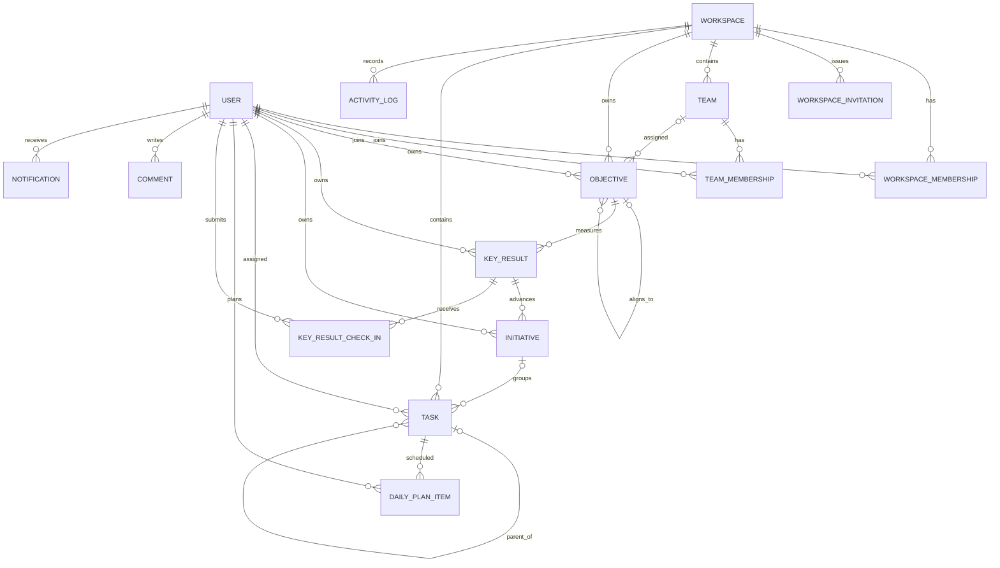

# Infraon Flow — Database Design Document

**Version:** 1.0  
**Status:** Draft for engineering implementation  
**Date:** 22 October 2026  
**Database:** PostgreSQL  
**Backend:** Python, Django, Django REST Framework

---

## 1. Purpose and scope

This document translates the Infraon Flow product requirements and system architecture into a practical relational database design: entities, columns, relationships, constraints, indexes, tenant-isolation rules, and implementation guidance.

Infraon Flow connects strategic objectives and measurable key results to initiatives and daily tasks. The model supports personal and business workspaces, multiple teams, and workspace-level data isolation.

**MVP includes:** users, workspaces, memberships, teams, objectives, key results, initiatives, tasks/subtasks, daily planning, key-result check-ins, comments, activity logs, notifications, and workspace invitations.

**Deferred:** billing, time tracking, Gantt/dependencies, advanced recurring tasks, attachments, external integrations, AI recommendations, and advanced approvals.

## 2. Design principles and invariants

1. Every business record belongs to a workspace; users may belong to multiple workspaces.
2. Workspace isolation is enforced by backend querysets, services, and permissions—not frontend filtering.
3. All referenced records in a tenant-owned relationship must belong to the same workspace.
4. A task may optionally link to an initiative; operational tasks can remain unlinked.
5. Subtasks are tasks linked through a self-referencing `parent_task_id`.
6. Daily planning does not change a task's due date.
7. Task completion never automatically changes key-result progress.
8. Key-result check-ins preserve historical outcome updates.
9. Use UUID primary keys and UTC `TIMESTAMPTZ` timestamps.
10. Use database constraints for integrity and transactions for multi-record operations.

## 3. Logical entity hierarchy

`Workspace → Objective → Key Result → Initiative → Task → Subtask`

Supporting relationships:
- `WorkspaceMembership` connects users to workspaces and defines workspace roles.
- Teams are contained by a workspace and have team memberships.
- Objectives may optionally align to a parent objective and optionally be assigned to a team.
- An initiative belongs to one key result in the initial release.
- Tasks always belong to a workspace but may have no initiative.
- `DailyPlanItem` plans an existing task for a user and date.
- `KeyResultCheckIn` records measured progress, confidence, blockers, and next steps.

## 4. ER diagram



## 5. Common schema conventions

| Concern | Convention |
|---|---|
| Primary key | `id UUID PRIMARY KEY` |
| Created timestamp | `created_at TIMESTAMPTZ NOT NULL DEFAULT now()` |
| Updated timestamp | `updated_at TIMESTAMPTZ NOT NULL DEFAULT now()` |
| Tenant key | `workspace_id UUID NOT NULL` on tenant-owned records |
| User reference | FK to custom Django user table |
| Progress | `NUMERIC(7,2)`, constrained to 0–100 |
| Metric values | `NUMERIC(18,4)` |
| Flexible metadata | `JSONB`, only for controlled metadata |
| Naming | `snake_case` columns; explicit Django related names |

Use a custom Django user model before the first migration. Use `settings.AUTH_USER_MODEL` for all user foreign keys. Prefer `PROTECT` for records with important history; use `CASCADE` only where lifecycle semantics are unambiguous.

## 6. Table specifications

All mutable entities should include `created_at` and `updated_at` unless stated otherwise. UUIDs are primary keys unless stated otherwise.

### 6.1 `users`

Custom Django user extending `AbstractUser` unless a different authentication model is justified.

| Column | Type | Rules / purpose |
|---|---|---|
| `id` | UUID | PK |
| `email` | VARCHAR(254) | NOT NULL, unique, normalized lowercase |
| `username` | VARCHAR(150) | Optional/derived based on auth configuration |
| `first_name`, `last_name` | VARCHAR(150) | Optional profile fields |
| `password` | VARCHAR(128) | Django password hash only; never plaintext |
| `is_active`, `is_staff` | BOOLEAN | NOT NULL; false for staff by default |
| `date_joined`, `last_login` | TIMESTAMPTZ | Join time required; last login nullable |
| `timezone` | VARCHAR(64) | User preference; application default may be `Asia/Kolkata` |

Unique normalized email. Use Django password hashing and standard account validation.

### 6.2 `workspaces`

| Column | Type | Rules / purpose |
|---|---|---|
| `id` | UUID | PK |
| `name` | VARCHAR(160) | NOT NULL |
| `slug` | VARCHAR(180) | NOT NULL; uniqueness policy to be confirmed |
| `workspace_type` | VARCHAR(20) | `personal` or `business` |
| `description` | TEXT | Nullable |
| `created_by_id` | UUID | FK → users; NOT NULL |
| `status` | VARCHAR(20) | `active`, `suspended`, `archived` |
| `archived_at` | TIMESTAMPTZ | Nullable |
| `created_at`, `updated_at` | TIMESTAMPTZ | Required |

Check `workspace_type`; index `(status, created_at)`. Decide whether slug uniqueness is global or scoped before public signup.

### 6.3 `workspace_memberships`

| Column | Type | Rules / purpose |
|---|---|---|
| `id` | UUID | PK |
| `workspace_id` | UUID | FK → workspaces; NOT NULL |
| `user_id` | UUID | FK → users; NOT NULL |
| `role` | VARCHAR(20) | `admin`, `team_lead`, `member` |
| `status` | VARCHAR(20) | `active`, `invited`, `suspended`, `left` |
| `joined_at` | TIMESTAMPTZ | Nullable until accepted |
| `created_at`, `updated_at` | TIMESTAMPTZ | Required |

Unique `(workspace_id, user_id)`. Index `(user_id, status)` and `(workspace_id, role, status)`. Active membership is required for workspace access.

### 6.4 `workspace_invitations`

| Column | Type | Rules / purpose |
|---|---|---|
| `id` | UUID | PK |
| `workspace_id` | UUID | FK → workspaces; NOT NULL |
| `email` | VARCHAR(254) | NOT NULL; normalized lowercase |
| `role` | VARCHAR(20) | Proposed membership role |
| `token_hash` | VARCHAR(255) | NOT NULL; hash only, never raw token |
| `invited_by_id` | UUID | FK → users; NOT NULL |
| `status` | VARCHAR(20) | `pending`, `accepted`, `expired`, `revoked` |
| `expires_at` | TIMESTAMPTZ | NOT NULL |
| `accepted_at` | TIMESTAMPTZ | Nullable |
| `created_at` | TIMESTAMPTZ | NOT NULL |

Unique `token_hash`; index `(workspace_id, email, status)`.

### 6.5 `teams`

| Column | Type | Rules / purpose |
|---|---|---|
| `id` | UUID | PK |
| `workspace_id` | UUID | FK → workspaces; NOT NULL |
| `name` | VARCHAR(120) | NOT NULL |
| `description` | TEXT | Nullable |
| `team_lead_id` | UUID | FK → users; nullable |
| `status` | VARCHAR(20) | `active`, `archived` |
| `created_at`, `updated_at` | TIMESTAMPTZ | Required |

Unique `(workspace_id, name)`; index `(workspace_id, status)`. Team lead must be an active workspace member.

### 6.6 `team_memberships`

| Column | Type | Rules / purpose |
|---|---|---|
| `id` | UUID | PK |
| `team_id` | UUID | FK → teams; NOT NULL |
| `user_id` | UUID | FK → users; NOT NULL |
| `role` | VARCHAR(20) | `lead` or `member` |
| `joined_at` | TIMESTAMPTZ | NOT NULL |
| `created_at` | TIMESTAMPTZ | NOT NULL |

Unique `(team_id, user_id)`; index `(user_id, team_id)`. Team membership alone does not grant workspace access.

### 6.7 `objectives`

| Column | Type | Rules / purpose |
|---|---|---|
| `id` | UUID | PK |
| `workspace_id` | UUID | FK → workspaces; NOT NULL |
| `parent_objective_id` | UUID | Self-FK; nullable |
| `team_id` | UUID | FK → teams; nullable |
| `owner_id` | UUID | FK → users; NOT NULL |
| `title` | VARCHAR(240) | NOT NULL |
| `description` | TEXT | Nullable |
| `level` | VARCHAR(20) | `company`, `team`, `individual` |
| `period_name` | VARCHAR(80) | e.g. `Q4 2026` |
| `start_date`, `end_date` | DATE | Required; end >= start |
| `status` | VARCHAR(20) | `draft`, `active`, `at_risk`, `completed`, `cancelled`, `archived` |
| `progress` | NUMERIC(7,2) | 0–100; derived/cache |
| `archived_at` | TIMESTAMPTZ | Nullable |
| `created_at`, `updated_at` | TIMESTAMPTZ | Required |

Constraints: `end_date >= start_date`; `progress BETWEEN 0 AND 100`; parent cannot equal self. Prevent hierarchy cycles in domain service logic. Index `(workspace_id, status, start_date, end_date)`, `(workspace_id, owner_id, status)`, and `(workspace_id, team_id, status)`. Parent/team must belong to same workspace.

Objective progress is the unweighted average of eligible active key results for MVP. If cached, update it transactionally or through a reliable recomputation mechanism.

### 6.8 `key_results`

| Column | Type | Rules / purpose |
|---|---|---|
| `id` | UUID | PK |
| `workspace_id` | UUID | FK → workspaces; NOT NULL, denormalized for tenant scoping |
| `objective_id` | UUID | FK → objectives; NOT NULL |
| `owner_id` | UUID | FK → users; NOT NULL |
| `title` | VARCHAR(240) | NOT NULL |
| `description` | TEXT | Nullable |
| `metric_type` | VARCHAR(20) | `increase`, `decrease`, `binary`, `milestone` |
| `unit` | VARCHAR(40) | Nullable, e.g. `%`, `users`, `hours` |
| `start_value`, `current_value`, `target_value` | NUMERIC(18,4) | Nullable for binary/manual milestone semantics |
| `progress` | NUMERIC(7,2) | 0–100; derived/cache |
| `confidence` | VARCHAR(20) | `low`, `medium`, `high`; nullable |
| `status` | VARCHAR(20) | `not_started`, `on_track`, `at_risk`, `off_track`, `completed` |
| `start_date`, `due_date` | DATE | Nullable |
| `sort_order` | INTEGER | NOT NULL DEFAULT 0 |
| `created_at`, `updated_at` | TIMESTAMPTZ | Required |

Index `(workspace_id, objective_id, sort_order)` and `(workspace_id, owner_id, status)`. Check progress range; validate metric-specific values and dates in domain logic. Objective must be in same workspace.

Progress rules: increase = `(current - start) / (target - start) * 100`; decrease = `(start - current) / (start - target) * 100`; binary = 0 or 100; milestone = explicit milestone aggregation if milestone rows are implemented, otherwise controlled manual progress. Clamp display to 0–100 and handle zero denominators. Tasks never directly change KR progress/current value.

### 6.9 `initiatives`

| Column | Type | Rules / purpose |
|---|---|---|
| `id` | UUID | PK |
| `workspace_id` | UUID | FK → workspaces; NOT NULL |
| `key_result_id` | UUID | FK → key_results; NOT NULL in MVP |
| `owner_id` | UUID | FK → users; NOT NULL |
| `title` | VARCHAR(240) | NOT NULL |
| `description` | TEXT | Nullable |
| `status` | VARCHAR(20) | `planned`, `in_progress`, `blocked`, `completed`, `cancelled` |
| `priority` | VARCHAR(20) | `low`, `medium`, `high`, `urgent` |
| `start_date`, `due_date` | DATE | Nullable |
| `completed_at` | TIMESTAMPTZ | Nullable |
| `created_at`, `updated_at` | TIMESTAMPTZ | Required |

Index `(workspace_id, key_result_id, status)` and `(workspace_id, owner_id, status)`. Key result must be in same workspace.

### 6.10 `tasks`

| Column | Type | Rules / purpose |
|---|---|---|
| `id` | UUID | PK |
| `workspace_id` | UUID | FK → workspaces; NOT NULL |
| `initiative_id` | UUID | FK → initiatives; nullable |
| `parent_task_id` | UUID | Self-FK → tasks; nullable |
| `created_by_id` | UUID | FK → users; NOT NULL |
| `assignee_id` | UUID | FK → users; nullable |
| `title` | VARCHAR(240) | NOT NULL |
| `description` | TEXT | Nullable |
| `status` | VARCHAR(20) | `todo`, `in_progress`, `blocked`, `done`, `cancelled` |
| `priority` | VARCHAR(20) | `low`, `medium`, `high`, `urgent` |
| `start_at`, `due_at` | TIMESTAMPTZ | Nullable |
| `completed_at` | TIMESTAMPTZ | Nullable |
| `sort_order` | INTEGER | NOT NULL DEFAULT 0 |
| `archived_at` | TIMESTAMPTZ | Nullable |
| `created_at`, `updated_at` | TIMESTAMPTZ | Required |

Indexes: `(workspace_id, assignee_id, status, due_at)`, `(workspace_id, status, priority, due_at)`, `(workspace_id, initiative_id, status)`, `(workspace_id, parent_task_id, sort_order)`. Check task is not its own parent. Parent and initiative must be in same workspace. Assignee/creator must be active workspace members. Recommend one subtask level for MVP. `initiative_id` may be null.

### 6.11 `daily_plan_items`

| Column | Type | Rules / purpose |
|---|---|---|
| `id` | UUID | PK |
| `workspace_id` | UUID | FK → workspaces; NOT NULL |
| `user_id` | UUID | FK → users; NOT NULL |
| `task_id` | UUID | FK → tasks; NOT NULL |
| `plan_date` | DATE | NOT NULL |
| `sort_order` | INTEGER | NOT NULL DEFAULT 0 |
| `note` | VARCHAR(500) | Nullable |
| `created_at` | TIMESTAMPTZ | NOT NULL |

Unique `(user_id, task_id, plan_date)` unless duplicate plan entries are a deliberate product feature. Index `(workspace_id, user_id, plan_date, sort_order)`. Task and user must belong to workspace. Planning must not update `tasks.due_at`.

### 6.12 `key_result_check_ins`

| Column | Type | Rules / purpose |
|---|---|---|
| `id` | UUID | PK |
| `workspace_id` | UUID | FK → workspaces; NOT NULL |
| `key_result_id` | UUID | FK → key_results; NOT NULL |
| `submitted_by_id` | UUID | FK → users; NOT NULL |
| `value` | NUMERIC(18,4) | Nullable for binary/manual updates |
| `progress` | NUMERIC(7,2) | NOT NULL; 0–100 snapshot |
| `confidence` | VARCHAR(20) | `low`, `medium`, `high` |
| `status` | VARCHAR(20) | Optional KR status snapshot |
| `notes`, `blockers`, `next_steps` | TEXT | Nullable |
| `created_at` | TIMESTAMPTZ | NOT NULL |

Index `(workspace_id, key_result_id, created_at DESC)`. Check progress range. KR and submitter must be in same workspace. Treat check-ins as append-only history.

### 6.13 `comments`

| Column | Type | Rules / purpose |
|---|---|---|
| `id` | UUID | PK |
| `workspace_id` | UUID | FK → workspaces; NOT NULL |
| `task_id` | UUID | FK → tasks; nullable |
| `initiative_id` | UUID | FK → initiatives; nullable |
| `key_result_id` | UUID | FK → key_results; nullable |
| `author_id` | UUID | FK → users; NOT NULL |
| `body` | TEXT | NOT NULL |
| `deleted_at` | TIMESTAMPTZ | Nullable |
| `created_at`, `updated_at` | TIMESTAMPTZ | Required |

Exactly one of `task_id`, `initiative_id`, `key_result_id` must be non-null (database check). Index each target with `created_at`. Validate target and author workspace. Add `objective_id` explicitly if objective comments are later required.

### 6.14 `activity_logs`

| Column | Type | Rules / purpose |
|---|---|---|
| `id` | UUID | PK |
| `workspace_id` | UUID | FK → workspaces; NOT NULL |
| `actor_id` | UUID | FK → users; nullable for system events |
| `entity_type` | VARCHAR(40) | NOT NULL |
| `entity_id` | UUID | NOT NULL; polymorphic target |
| `action` | VARCHAR(60) | NOT NULL |
| `summary` | VARCHAR(500) | NOT NULL |
| `metadata` | JSONB | NOT NULL DEFAULT `{}`; no secrets |
| `created_at` | TIMESTAMPTZ | NOT NULL |

Indexes `(workspace_id, created_at DESC)`, `(workspace_id, entity_type, entity_id, created_at DESC)`, and `(actor_id, created_at DESC)`. Polymorphic target/workspace integrity is validated in service logic.

### 6.15 `notifications`

| Column | Type | Rules / purpose |
|---|---|---|
| `id` | UUID | PK |
| `workspace_id` | UUID | FK → workspaces; NOT NULL |
| `recipient_id` | UUID | FK → users; NOT NULL |
| `actor_id` | UUID | FK → users; nullable |
| `notification_type` | VARCHAR(50) | NOT NULL |
| `title` | VARCHAR(180) | NOT NULL |
| `body` | VARCHAR(500) | Nullable |
| `entity_type`, `entity_id` | VARCHAR(40), UUID | Optional reference validated in service |
| `read_at` | TIMESTAMPTZ | Nullable |
| `created_at` | TIMESTAMPTZ | NOT NULL |

Indexes `(recipient_id, read_at, created_at DESC)` and `(workspace_id, created_at DESC)`. Recipient must be a workspace member.

## 7. Relationship and cardinality summary

| Parent | Child | Cardinality | Rule |
|---|---|---|---|
| User | WorkspaceMembership | 1:N | User joins multiple workspaces |
| Workspace | WorkspaceMembership | 1:N | Unique per user/workspace |
| Workspace | Team | 1:N | Team belongs to one workspace |
| Team | TeamMembership | 1:N | Unique per team/user |
| Workspace | Objective | 1:N | Objective is tenant-owned |
| Objective | KeyResult | 1:N | KR belongs to one objective |
| KeyResult | Initiative | 1:N | Initiative advances one KR |
| Workspace | Task | 1:N | Task always has workspace |
| Initiative | Task | 1:N optional | Task may be unlinked |
| Task | Task | 1:N optional | Self-reference for subtasks |
| User | DailyPlanItem | 1:N | User plans tasks by date |
| Task | DailyPlanItem | 1:N | Task can be planned on multiple dates |
| KeyResult | KeyResultCheckIn | 1:N | Progress history |

## 8. Tenant isolation and cross-workspace integrity

This is a critical security requirement.

1. Resolve active workspace from authenticated request context (for example, `X-Workspace-ID`) and verify active `WorkspaceMembership`.
2. Scope every tenant-owned queryset by the resolved workspace before retrieval or mutation.
3. Validate every referenced object belongs to the same workspace on create/update.
4. Never trust client-supplied workspace IDs, owners, actors, or roles without authorization checks.
5. Team membership does not imply workspace membership.
6. Return `404` for inaccessible cross-tenant objects where appropriate to avoid disclosing their existence.
7. Consider composite constraints and foreign keys for tenant-owned relationships.
8. PostgreSQL Row-Level Security (RLS) can be added as defense in depth after connection pooling and session context are designed; it does not replace application permissions.

### 8.1 Recommended composite constraints

Where practical, add unique `(workspace_id, id)` keys and composite foreign keys such as:
- `key_results(workspace_id, objective_id)` → `objectives(workspace_id, id)`
- `initiatives(workspace_id, key_result_id)` → `key_results(workspace_id, id)`
- `tasks(workspace_id, initiative_id)` → `initiatives(workspace_id, id)`
- `tasks(workspace_id, parent_task_id)` → `tasks(workspace_id, id)`
- `daily_plan_items(workspace_id, task_id)` → `tasks(workspace_id, id)`

Verify migration SQL and test nullable composite references. Django may require explicit migrations/SQL for some composite constraints.

## 9. Indexing strategy

| Query pattern | Recommended index |
|---|---|
| Workspace dashboard | `(workspace_id, status)` on objectives/tasks |
| My Tasks | `(workspace_id, assignee_id, status, due_at)` |
| Overdue tasks | `(workspace_id, status, due_at)`; consider partial index |
| Initiative task list | `(workspace_id, initiative_id, status)` |
| Objective detail | `(workspace_id, objective_id, sort_order)` on KRs |
| KR check-in timeline | `(workspace_id, key_result_id, created_at DESC)` |
| My Day | `(workspace_id, user_id, plan_date, sort_order)` |
| Workspace switcher | `(user_id, status)` on memberships |
| Unread notifications | `(recipient_id, read_at, created_at DESC)` |

Index based on observed query patterns. Use `EXPLAIN (ANALYZE, BUFFERS)` with representative data. Consider partial indexes for active records; avoid indexing large description fields without a demonstrated search requirement.

## 10. Status values and validation

Use Django `TextChoices` backed by `VARCHAR` plus database check constraints for stable finite values. Native PostgreSQL enums are possible but may make schema evolution less convenient.

- Workspace type: `personal`, `business`
- Workspace status: `active`, `suspended`, `archived`
- Workspace role: `admin`, `team_lead`, `member`
- Objective level: `company`, `team`, `individual`
- Objective status: `draft`, `active`, `at_risk`, `completed`, `cancelled`, `archived`
- KR metric type: `increase`, `decrease`, `binary`, `milestone`
- KR status: `not_started`, `on_track`, `at_risk`, `off_track`, `completed`
- Initiative status: `planned`, `in_progress`, `blocked`, `completed`, `cancelled`
- Task status: `todo`, `in_progress`, `blocked`, `done`, `cancelled`
- Priority: `low`, `medium`, `high`, `urgent`

Do not reuse one status enum across entity types if lifecycle semantics differ.

## 11. Delete, archive, and retention policy

| Entity | Recommended behavior |
|---|---|
| User | Deactivate/anonymize under retention policy; preserve business history |
| Workspace | Archive first; controlled hard delete only after retention/export policy |
| Membership | Mark `left` or `suspended`; retain historical actor references |
| Team | Archive; preserve objective history |
| Objective / KR | Archive or cancel; preserve check-ins |
| Initiative | Cancel/archive; preserve tasks and activity |
| Task | Archive or cancel; preserve comments/activity |
| Check-in | Append-only; no ordinary hard delete |
| Activity log | Append-only with defined retention |
| Notification | Dismiss/delete per product policy |

Prefer `PROTECT` and explicit lifecycle transitions for historical data. Define workspace export/deletion policy before production.

## 12. Transactions and consistency

Use `transaction.atomic()` for:
- Creating a workspace and its initial admin membership.
- Accepting an invitation and creating/updating membership.
- Creating an objective with initial key results.
- Moving a task between initiatives after workspace validation.
- Recording a KR check-in and updating the KR snapshot/progress.
- Recalculating objective progress after KR changes.
- Completing a task and recording its activity event.

Use `select_for_update()` where concurrent updates could overwrite each other, especially KR current values and invitation acceptance. Write activity events in the same transaction as the business mutation where feasible.

## 13. Django implementation guidance

### 13.1 Initial setup

- Create custom user model before the first migration.
- Set `AUTH_USER_MODEL` before initial migrations.
- Use UUID primary keys consistently and `settings.AUTH_USER_MODEL` for user FKs.
- Keep domain rules in service functions, not only serializers.
- Define `Meta.constraints` and `Meta.indexes` explicitly.
- Use migrations for every schema change; do not manually edit production schema.

### 13.2 Suggested app structure

```text
backend/
  config/
  apps/
    accounts/       # user model, managers, auth services
    workspaces/     # workspace, memberships, invitations, permissions
    teams/           # teams and team memberships
    okrs/            # objectives, key results, check-ins, progress services
    initiatives/     # initiatives
    tasks/           # tasks, subtasks, daily planning
    collaboration/   # comments, activity logs, notifications
```

Apps may be combined initially to keep the MVP simple, while retaining clear domain boundaries.

### 13.3 Recommended Django field types

- `UUIDField(primary_key=True, default=uuid.uuid4, editable=False)`
- `DateTimeField(auto_now_add=True)` and `DateTimeField(auto_now=True)`
- `DecimalField(max_digits=18, decimal_places=4)` for KR values
- `DecimalField(max_digits=7, decimal_places=2)` for progress
- `JSONField(default=dict)` for controlled activity metadata
- `TextChoices` for statuses and roles

## 14. API/query implications

All tenant-owned endpoints must be scoped to the active workspace:
- `GET /api/v1/objectives/` — active-workspace objectives only.
- `GET /api/v1/objectives/{id}/key-results/` — verify objective workspace before returning KRs.
- `GET /api/v1/tasks/` — filter by assignee/status/priority/due date within active workspace.
- `POST /api/v1/daily-plan-items/` — validate task and user belong to active workspace.
- `POST /api/v1/key-results/{id}/check-ins/` — authorize, persist check-in, and update KR snapshot atomically.

Use consistent pagination and filtering. Return `404` for inaccessible cross-tenant objects where appropriate.

## 15. Backup and operations

- Automate PostgreSQL backups and regularly test restores.
- Define RPO and RTO before pilot/production.
- Maintain separate development, staging, and production databases.
- Keep secrets out of source control and database rows.
- Run migrations as a controlled deployment step with rollback planning.
- Define retention/archive strategy for activity logs and notifications as volume grows.
- Monitor connection count, slow queries, storage, backup success, and replication lag if replicas are added.

## 16. Data dictionary summary

| Table | Purpose | Tenant-scoped |
|---|---|---|
| `users` | Authentication identity/profile | No |
| `workspaces` | Personal/business tenant | Root |
| `workspace_memberships` | User access and role | Yes |
| `workspace_invitations` | Invitation lifecycle | Yes |
| `teams` | Workspace teams | Yes |
| `team_memberships` | Team membership | Yes |
| `objectives` | Strategic outcomes | Yes |
| `key_results` | Measurable outcomes | Yes |
| `initiatives` | Work linked to a KR | Yes |
| `tasks` | Operational work/subtasks | Yes |
| `daily_plan_items` | User/date planning | Yes |
| `key_result_check_ins` | KR progress history | Yes |
| `comments` | Entity discussion | Yes |
| `activity_logs` | Audit/event trail | Yes |
| `notifications` | In-app inbox | Yes |

## 17. Open decisions before production

1. Workspace slug uniqueness: global or scoped to an organization/domain.
2. Objective periods: free-form label plus dates for MVP, or dedicated `okr_periods` table.
3. Milestone KRs: milestone child records in MVP or controlled manual progress.
4. Objective weighting: unweighted average for MVP or explicit KR weights.
5. Subtask depth: recommend one level initially or unlimited hierarchy.
6. Task assignment: allow unassigned tasks; defer multiple assignees.
7. Confirm commentable entity types.
8. Define check-in/activity retention and workspace deletion/export policy.
9. Decide whether to add PostgreSQL RLS as defense in depth.
10. Decide whether signup automatically creates a personal workspace.

## 18. Recommended implementation order

1. Custom User model and account migrations.
2. Workspace, WorkspaceMembership, and invitation models.
3. Workspace context resolution and tenant permission tests.
4. Team and TeamMembership.
5. Objective and KeyResult models plus progress services.
6. Initiative model.
7. Task and subtask model.
8. DailyPlanItem.
9. KeyResultCheckIn and transactional progress updates.
10. Comments, activity logs, and notifications.
11. Index review using representative data and query plans.

## 19. Acceptance criteria

- A user can belong to multiple workspaces.
- No user can read or modify workspace records without active membership.
- All cross-entity references are validated to belong to the same workspace.
- Tasks can be created without an initiative.
- Tasks support parent/subtask relationships within the configured depth.
- Daily planning does not alter task due dates.
- Task completion does not automatically change KR progress.
- KR check-ins preserve historical progress and notes.
- Objective progress follows the agreed aggregation rule.
- Archive/deactivation behavior preserves required history.
- Critical uniqueness, range, and referential constraints are enforced in the database wherever practical.

---

**Document owner:** Infraon Flow Engineering  
**Classification:** Internal  
**Next artifact:** Django model specification and migration-ready implementation plan
